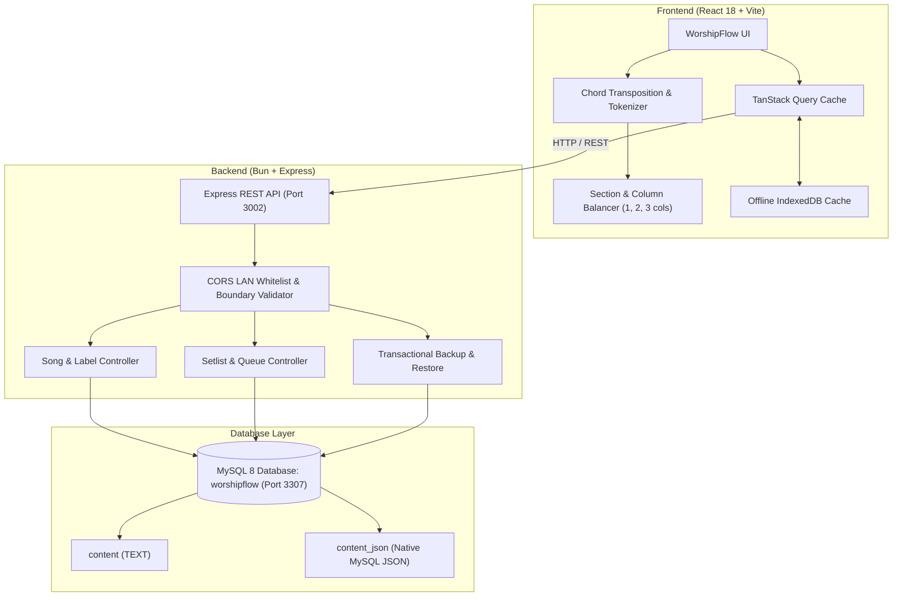

# WorshipFlow

<div align="center">

**Every song. Every moment. One flow.**

A modern, full-stack worship song and chord management platform for musicians, worship leaders, and church bands. Designed for cataloging, transposing, rehearsing, and performing live with zero friction.

[](https://www.typescriptlang.org/)
[](https://reactjs.org/)
[](https://vitejs.dev/)
[](https://tailwindcss.com/)
[](https://bun.sh/)
[](https://expressjs.com/)
[](https://www.mysql.com/)
[](LICENSE)

</div>

---

## 📖 Table of Contents

- [Overview](#-overview)
- [Key Features](#-key-features)
- [Screenshots](#-screenshots)
- [Technology Stack](#-technology-stack)
- [System Architecture](#-system-architecture)
- [Prerequisites](#-prerequisites)
- [Installation & Quick Start](#-installation--quick-start)
- [Environment Configuration](#-environment-configuration)
- [Database Setup & Migrations](#-database-setup--migrations)
- [Available Commands](#-available-commands)
- [Project Structure](#-project-structure)
- [Security & Best Practices](#-security--best-practices)
- [Contributing](#-contributing)
- [License](#-license)

---

## 🌟 Overview

**WorshipFlow** solves the real-world challenges faced by worship teams during rehearsals and live services:
- **Instant Transposition:** Seamlessly shift songs to any key without messy formatting or broken syllable alignment.
- **Stage-Ready Performance:** Full-screen performance view with dark/light modes, autoscrolling, multi-column layouts, and setlist queuing.
- **Multi-Device Live Sync:** Access the songbook across iPads, Android tablets, phones, and laptops on the church local network.
- **Reliable Offline Access:** Perform without worry—all viewed songs and setlists are cached in IndexedDB for 100% offline playback.
- **Full Data Ownership:** Centralized MySQL storage with dual raw-bracket and structured JSON document formats (`worshipflow-song` v1), plus automated full-library JSON backups.

---

## ✨ Key Features

### 🎸 Chord Notation & Transposition Engine
- **Inline Bracket Notation:** Simple, musician-friendly input (`[C]Amazing [G]grace how [Am]sweet the [F]sound`).
- **Real-Time Pitch Shifting:** Transpose by semitones (`-1`, `+1`) or reset to original key using interactive toolbar or keyboard shortcuts (`↑` / `↓`).
- **Complex Chord Support:** Recognizes basic majors/minors, sevenths, extensions (`add9`, `sus2`, `sus4`, `dim`, `aug`, `m7b5`, `maj7`, `maj9`), and slash chords (`C/E`, `F#/A#`).
- **Lyric & Header Preservation:** Protects bracketed performance annotations (`[Intro]`, `[Chorus]`, `[Bridge]`, `[Fade out]`) from accidental pitch alterations and lyric truncation.

### 📄 Multi-Column Layout & Text Sizing
- **Balanced Column Dividing:** Dynamically distributes long songs into **1, 2, or 3 balanced columns** without splitting stanzas awkwardly.
- **Oversized Verse Splitting:** Automatically balances long continuous verses across columns with clean continuation headers (`(cont.)`).
- **Layout Divider Rules:** Subtle dashed vertical separators and line-level overflow protection prevent text overlap.
- **Adjustable Font Size:** Clamped stepper (`12px` to `36px`) with step increments (`A-`, `A+`) and a one-click reset to `18px`.

### 🎤 Full-Screen Live Performance Mode
- **Distraction-Free UI:** Maximizes chord sheet visibility with high contrast and customizable line spacing (`Normal`, `Relaxed`, `Loose`).
- **Smooth Auto-Scroll:** Variable speed auto-scrolling (`1` to `5`) with Spacebar pause/play toggle.
- **Screen Wake Lock:** Prevents device screens from dimming or sleeping mid-performance.
- **Key Sync:** Transposition changes made during live performance automatically persist back to the song library.
- **Mobile Live Strip:** Compact secondary control bar providing quick font sizing and column cycling on smartphones.

### 📋 Setlists & Live Queue Navigation
- **Setlist Organization:** Assemble setlists for Sunday services, youth nights, and rehearsals.
- **Per-Song Key Offsets:** Save key transposition presets per setlist item.
- **Scheduled Next Song:** Queue up any song in the setlist on-the-fly during a performance without disrupting the current track.

### 🏷️ Categorization & Search
- **Instant Search:** Debounced client/server full-text search across titles, artists, and lyrics.
- **Color-Coded Labels:** Tag songs by genre, mood, service section, or instrument (`Guitar`, `Piano`, `Ukulele`, `Bass`, `Mandolin`).
- **Favorites Quick Filter:** One-click filtering in sidebar for starred worship tracks.

### 💾 Backup, Export & Offline Access
- **Single-Song Export:** Export formatted JSON documents (`.worshipflow`).
- **Print & PDF Export:** Clean A4 printable sheets and vector PDF generation.
- **High-Res PNG Snapshot:** Canvas screenshot export for quick sharing in messaging apps.
- **Full-Library Backup & Restore:** Export complete database (songs, setlists, labels, relationships) with safe, atomic, transactional restoration.
- **Offline Mode:** Built-in IndexedDB layer caches songs locally for offline rehearsals and mission trips.

---

## 📸 Screenshots

<!-- Replace these placeholder comments with actual screenshots when available -->

| Song Detail & Multi-Column View | Full-Screen Performance Mode |
|:---:|:---:|
|  |  |

| Setlist Live Management | Mobile Performance View |
|:---:|:---:|
|  |  |

---

## 🛠️ Technology Stack

| Layer | Technologies |
|---|---|
| **Frontend Framework** | React 18.3, TypeScript 5.3, Vite 8.3 |
| **Styling & Theme** | Tailwind CSS v3 (Forest Green `#198754`, Dark Forest `#101A16`, Warm White `#FAFAF6`) |
| **State & Data Fetching** | TanStack Query v5 (React Query) |
| **Routing & Forms** | React Router DOM v6, React Hook Form v7, Zod v3 |
| **Icons & UI Helpers** | Lucide React, clsx, tailwind-merge |
| **Export Engines** | jsPDF, html2canvas |
| **Backend Runtime** | Bun 1.3 (Ultra-fast JavaScript/TypeScript runtime) |
| **Web Server** | Express 4 with modular router architecture |
| **Database** | MySQL 8 (`worshipflow` on port 3307, `utf8mb4_unicode_ci`) |
| **Database Client** | `mysql2/promise` with connection pooling |
| **Testing** | Bun Test runner, custom API & chord engine integration test suites |

---

## 🏛️ System Architecture



---

## 📋 Prerequisites

Before installing WorshipFlow, ensure you have the following installed:

1. **Bun** (v1.1+ or v1.3+ recommended): [Install Bun](https://bun.sh/)
   ```bash
   # Windows (PowerShell)
   powershell -c "irm bun.sh/install.ps1 | iex"
   
   # macOS / Linux
   curl -fsSL https://bun.sh/install | bash
   ```
2. **MySQL 8.x**: Running locally (default port: `3307` or `3306`).
3. **Git**: [Install Git](https://git-scm.com/)

---

## 🚀 Installation & Quick Start

### 1. Clone the Repository
```bash
git clone https://github.com/Obed404/WorshipFlow.git
cd WorshipFlow
```

### 2. Install Dependencies
Install dependencies for both frontend and backend from the root workspace:
```bash
bun install
```

### 3. Configure Environment Variables
Copy the example environment file in the backend directory:
```bash
# Windows PowerShell
Copy-Item backend\.env.example backend\.env

# Linux / macOS
cp backend/.env.example backend/.env
```

Edit `backend/.env` with your MySQL database credentials (see [Environment Configuration](#-environment-configuration)).

### 4. Setup the Database
Initialize and migrate the `worshipflow` database:
```bash
bun run database/migrate_to_worshipflow.ts
```
*(Alternatively, you can run `database/setup.ps1` in PowerShell).*

### 5. Start the Application
Run both backend and frontend concurrently:
```bash
bun run dev
```

- **Frontend Application:** [http://localhost:5173](http://localhost:5173)
- **Backend API:** [http://localhost:3002/api](http://localhost:3002/api)
- **API Health Check:** [http://localhost:3002/api/health](http://localhost:3002/api/health)

---

## ⚙️ Environment Configuration

The backend is configured via `backend/.env`. A safe template is provided in `backend/.env.example`:

| Variable | Default Value | Description |
|---|---|---|
| `NODE_ENV` | `development` | Runtime environment (`development`, `production`, `test`) |
| `PORT` | `3002` | Port on which the Express server listens |
| `DB_HOST` | `127.0.0.1` | MySQL server hostname or IP address |
| `DB_PORT` | `3307` | MySQL port (change to `3306` if using standard MySQL port) |
| `DB_NAME` | `worshipflow` | Active database name |
| `DB_USER` | `root` | Database username |
| `DB_PASSWORD` | `your_password_here` | Database user password |
| `DB_POOL_MIN` | `2` | Minimum connection pool size |
| `DB_POOL_MAX` | `10` | Maximum connection pool size |
| `CORS_ORIGIN` | `http://localhost:5173` | Allowed frontend origin (LAN IPs automatically permitted) |
| `LOG_LEVEL` | `info` | Logging verbosity (`error`, `warn`, `info`, `debug`) |

> [!IMPORTANT]
> Never commit `.env` files or actual passwords to source control. `.env` is strictly ignored in `.gitignore`.

---

## 🗄️ Database Setup & Migrations

WorshipFlow uses MySQL 8 as its single source of truth.

### Database Tables:
- `songs`: Title, artist, key, capo, tempo, difficulty, `content` (raw brackets), and `content_json` (structured JSON document).
- `labels`: Color-coded tags and optional instrument classifications.
- `song_labels`: Many-to-many junction between songs and labels.
- `setlists`: Setlist metadata, service dates, and notes.
- `setlist_songs`: Ordered junction of songs in setlists with custom key offsets.

### Migration & Database Scripts:
```bash
# Setup new database and migrate existing songs
bun run database/migrate_to_worshipflow.ts

# Audit databases and compare record counts
bun run database/audit_databases.ts

# Roll back configuration to legacy chord_viewer if needed
bun run database/rollback_to_chord_viewer.ts
```

Database schema definitions are located in `database/structure/1_initial.sql` and default seed data is in `database/seed/1_initial.sql`.

---

## ⌨️ Available Commands

From the workspace root directory:

| Command | Action |
|---|---|
| `bun run dev` | Starts backend (port `3002`) and frontend (port `5173`) concurrently |
| `bun run build` | Compiles backend bundle (`dist/index.js`) and builds Vite frontend (`dist/`) |
| `bun run test` | Runs the full verification test suite across frontend and backend |
| `bun --cwd frontend dev` | Starts only the Vite frontend dev server |
| `bun --cwd frontend test` | Runs frontend unit tests with Bun Test |
| `bun --cwd backend dev` | Starts backend server with hot-reload (`bun --hot`) |
| `bun --cwd backend test` | Runs backend API integration tests |

### Specialized Test Scripts:
```bash
# Run 19 frontend chord engine and column layout tests
cd frontend; bun test

# Run full chord engine verification suite (14 suites)
cd frontend; bun test-chord-engine.ts

# Run backend API integration tests (health, CRUD, validation)
cd backend; bun test-api-integration.ts

# Run full-library backup and restore tests
cd backend; bun test-backup-restore.ts

# Run security, CORS LAN, and boundary reliability tests
cd backend; bun test-security-reliability.ts

# Run TypeScript compilation checks
cd frontend; bun x tsc --noEmit
cd backend; bun x tsc --noEmit
```

---

## 📂 Project Structure

```
WorshipFlow/
├── backend/
│   ├── src/
│   │   ├── index.ts                     # Express server & LAN CORS setup
│   │   ├── routes/                      # Aggregated API routes
│   │   └── modules/
│   │       ├── common/                  # Database client, error handlers, env validator
│   │       ├── songs/                   # Songs controller, repository, converters
│   │       ├── labels/                  # Labels controller & repository
│   │       ├── setlists/                # Setlists controller, repository & reordering
│   │       └── backup/                  # Full-library export & restore handlers
│   ├── .env.example                     # Backend environment template
│   ├── package.json                     # Backend dependencies & scripts
│   └── tsconfig.json                    # Backend TypeScript configuration
├── database/
│   ├── structure/1_initial.sql          # MySQL table definitions
│   ├── seed/1_initial.sql               # Default sample worship songs
│   ├── migrate_to_worshipflow.ts        # Migration script with JSON conversion
│   └── setup.ps1                        # PowerShell setup utility
├── frontend/
│   ├── src/
│   │   ├── App.tsx                      # Root providers (QueryClient, ThemeProvider)
│   │   ├── main.tsx                     # React DOM entry point
│   │   ├── components/layout/           # Responsive sidebar, navigation & header
│   │   ├── components/ui/               # Accessible buttons, modals, badges, inputs
│   │   ├── lib/
│   │   │   ├── chords/                  # Chord parser, tokenizer & transposition engine
│   │   │   ├── export/                  # PDF, PNG, and JSON export utilities
│   │   │   ├── hooks/                   # useSongViewSettings, useFavorites, etc.
│   │   │   └── offline/                 # IndexedDB offline storage layer
│   │   └── modules/
│   │       ├── songs/                   # SongCard, ChordSheet, TransposeBar, Modal
│   │       ├── labels/                  # Label management & color picker
│   │       └── setlists/                # Setlist management & drag-and-drop
│   ├── .env.example                     # Frontend optional environment template
│   ├── package.json                     # Frontend dependencies & scripts
│   ├── tailwind.config.js               # Theme colors, fonts & responsive rules
│   └── vite.config.ts                   # Vite config with backend API proxy
├── .gitignore                           # Excludes secrets, node_modules, backups
├── bun.lock                             # Bun dependency lockfile
├── package.json                         # Workspace root package configuration
└── README.md                            # Project documentation
```

---

## 🔒 Security & Best Practices

- **Strict Secret Isolation:** `.env` files, production credentials, and database passwords are never committed.
- **LAN CORS Security:** Origin whitelisting specifically permits local loopback (`localhost`, `127.0.0.1`) and RFC 1918 private LAN ranges (`192.168.0.0/16`, `10.0.0.0/8`, `172.16.0.0/12`), blocking untrusted public internet origins while enabling multi-device church band connectivity.
- **Payload Size & Boundary Caps:** Backup restorations validate upper payload bounds (max 5,000 songs, 1,000 labels, 500 setlists) to protect server memory.
- **Transactional Safety:** All multi-step write operations (song creation with labels, full library restores) execute within atomic MySQL transactions that roll back completely on failure.
- **Backup Exclusion:** The `database/backup/` directory is strictly excluded in `.gitignore` to prevent database dumps from leaking to remote repositories.

---

## 🤝 Contributing

Contributions are welcome! Please follow these steps:

1. **Fork the repository** on GitHub.
2. **Create a feature branch:**
   ```bash
   git checkout -b feature/amazing-feature
   ```
3. **Commit your changes:**
   ```bash
   git commit -m "Add amazing feature"
   ```
4. **Run tests & verification:**
   ```bash
   bun run test
   ```
5. **Push to the branch:**
   ```bash
   git push origin feature/amazing-feature
   ```
6. **Open a Pull Request** describing your changes.

---

## 📄 License

This project is open-source and available under the [MIT License](LICENSE).

---

<div align="center">
Made with ❤️ for worship leaders, bands, and musicians worldwide.
</div>
